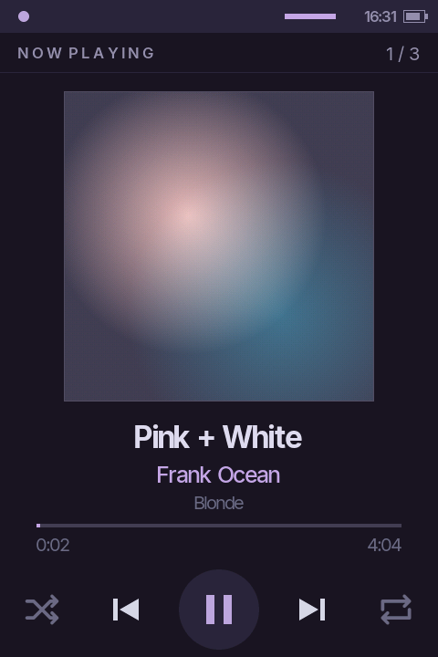
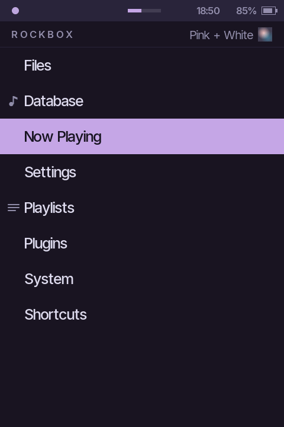
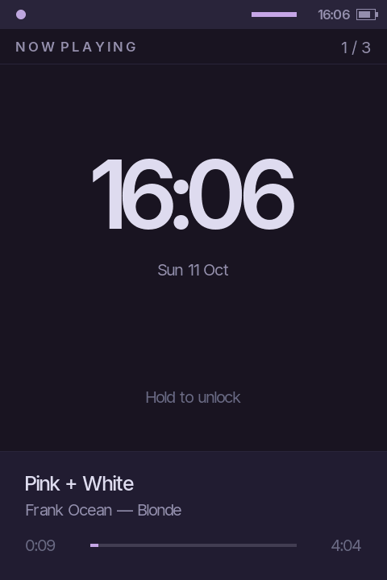
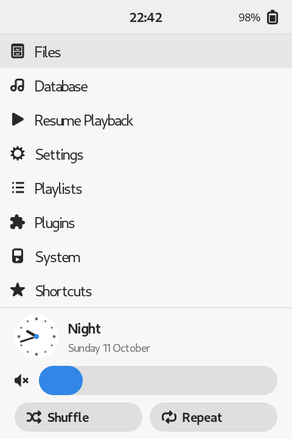
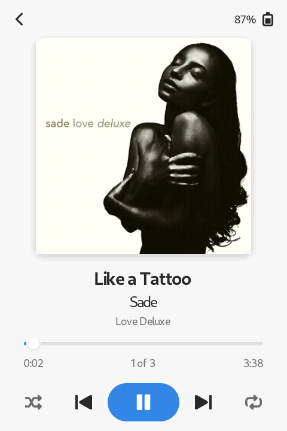
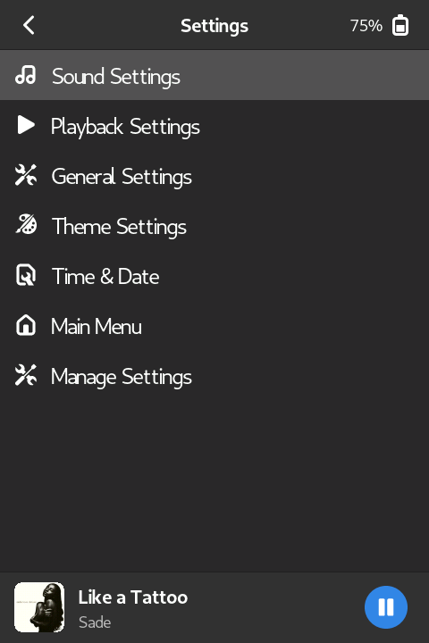
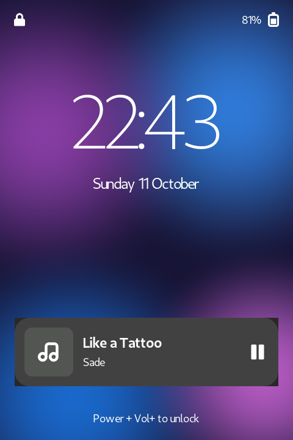

# rockbox-themes

Custom [Rockbox](https://www.rockbox.org/) themes, organised per device.

| Device | Screen | Folder |
|---|---|---|
| HiBy R3 Pro II | 480 × 720 portrait, touch | [`hiby-r3proii/`](hiby-r3proii/) |

## Themes

| Theme | Device | Look | Preview |
|---|---|---|---|
| `iris-r3` | HiBy R3 Pro II | Quiet and minimal, Rosé Pine palette, touch controls. A portrait redesign of [Iris](https://github.com/gloceandotdev/iris-rockbox-theme). | [`previews/iris-r3.html`](hiby-r3proii/previews/iris-r3.html) |
| `adwaitapod-r3`, `adwaitapod-r3-dark` | HiBy R3 Pro II | GNOME style in light and dark: home screen widgets, mini player, quick screen sliders, lock screen. A portrait redesign of [adwaitapod](https://github.com/D0-0K/adwaitapod). | [`previews/adwaitapod-r3.html`](hiby-r3proii/previews/adwaitapod-r3.html) |

**iris-r3**

  

**adwaitapod-r3** (light and dark)

   

Screenshots are from the Rockbox UI simulator.

[`previews/theme-shortlist.html`](hiby-r3proii/previews/theme-shortlist.html) compares the themes considered for the R3 Pro II. Open preview pages locally in a browser.

## Install

Requirements: macOS, a player with Rockbox already installed, and its SD card mounted. Both arguments are required: the device folder and the card's mount point (check with `ls /Volumes`).

```bash
./install.sh hiby-r3proii /Volumes/R3PROII            # install
./install.sh hiby-r3proii /Volumes/R3PROII --dry-run  # list what would be copied
```

The script merges the device's `.rockbox/` folder into the card's `.rockbox/` with `ditto --norsrc`, then runs `dot_clean` to remove macOS `._*` files. It never deletes anything on the card and never touches Rockbox's built-in themes or your `config.cfg`.

**Note:** because it only merges, files removed or renamed in this repo are not removed from the card. Delete stale files on the card by hand if needed.

Then eject the card, put it in the player and go to **Settings → Theme Settings → Browse Theme Files** to select a theme. **When updating a theme that's already selected, restart the player and then select the theme again.** Restarting reloads the skin files (selecting the same theme doesn't); selecting it applies the theme's `.cfg` settings such as icons, scrollbar and colours (restarting doesn't). If a theme breaks the UI, select `cabbiev2` or `rockbox_failsafe` there to recover.

## Developing themes

Themes can be checked and previewed on a Mac with Rockbox's UI simulator, without copying them to the player. Set it up once with `tools/setup.sh`, then run `./simulate.sh hiby-r3proii iris-r3`. [DEV.md](DEV.md) explains the workflow, what needs rebuilding when, and skin-engine pitfalls.

## Layout

Each device folder contains:

- `.rockbox/`: exactly what gets copied onto the card (`themes/`, `wps/`, `backdrops/`, `icons/`, `fonts/`)
- `src/`: scripts and source art used to build the theme files, not deployed
- `previews/`: HTML previews of the themes, not deployed
- `screenshots/`: images for this README

Every file belonging to a theme starts with the theme's name, so several themes can coexist. Fonts are the exception: they keep their own names (e.g. `30-Inter-Medium.fnt`) so themes can share them. A theme's variants (e.g. `adwaitapod-r3-dark`) are separate themes with their own files.

## Credits and licence

Adapted themes and their original licences are listed in [CREDITS.md](CREDITS.md). Original work in this repo is licensed as described in [LICENSE](LICENSE).
